<h1 align="center">I Never Showed It the Task</h1>
<p align="center"><b>Composing multi-step manipulation from single-skill videos</b></p>
<p align="center"><i>Can a robot that only knows single skills do long tasks it was never shown?</i></p>

<p align="center">
  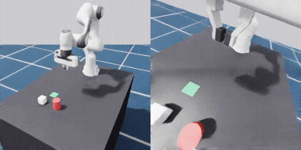
</p>
<p align="center"><sub><b>Six commands from one sentence, in order (3×).</b> The example sentence: <i>"Pick up the cube, then put the cube on the cylinder, then pick up the cube, then put the cube on the target, then pick up the cylinder, then put the cylinder on the cube."</i> Left: front camera. Right: wrist camera.</sub></p>

**Abstract.** People rarely learn a task as a whole. We learn a few basic skills, like picking things up and putting them down, and reuse them everywhere: on objects we have never held, on tables we have never seen, and in sequences nobody demonstrated. Someone who can pick up a cup and can put one down doesn't need to be shown how to move a cup to the shelf; that task is just the two skills, one after the other. This project asks whether a small vision-language-action model (VLA) can do the same: learn only single skills, then carry out long multi-step tasks it was never trained on.

I filmed myself on my phone doing single skills (pushing, picking up, putting down) and never recorded two consecutive skills. From the tracked object paths I built a reward, trained an RL teacher in simulation on episodes of at most two commands, and distilled it into SmolVLA (450M), which sees only two cameras and one sentence listing every command. The hard part is memory: from the camera alone the model can't tell which step it is on, so it has to track its own progress through the sentence. On 100 held-out layouts it completes a 4-step task in order 81 times and a 6-step task 40 times, yet it never trained on a single 4- or 6-step task: every training episode had at most two steps. **The long tasks are composed entirely at inference!**

For example, the robot gets this sentence once, at the start:

```
pick up the cube, then put the cube on the cylinder, then pick up the cube,
then put the cube on the target, then pick up the cylinder, then put the cylinder on the cube
```

Each part between the commas is a **command**: one skill (pick up, put down, push) applied to one object, plus where it goes when the skill needs a destination, e.g. *put the cube on the cylinder*. This sentence has six. Nothing splits it up, and the simulator never tells the policy which command it's on.

<p align="center"><b>Click the buttons below to play with the robot live and to see the project page on my website.</b></p>
<p align="center">
  <a href="https://theundercover01.github.io/ayushdeshmukh/projects/play/"></a>
</p>
<p align="center">
  <a href="https://theundercover01.github.io/ayushdeshmukh/projects/never-shown/"></a>
</p>

## Results

Success rate (%) over 100 held-out table layouts per task. A run succeeds only if the simulator registers every command of the sentence as completed, in order (see [Experimental setup](#3--experimental-setup)).

| Task, and the sentence the robot gets | Steps | Student (2 RGB cameras + sentence) | Teacher (privileged state, told the current step) |
| :--- | :---: | ---: | ---: |
| Pick up the cube<br><sub><i>"pick up the cube"</i></sub> | 1 | 94 | 100 |
| Pick up the cylinder<br><sub><i>"pick up the cylinder"</i></sub> | 1 | 59 | 100 |
| Push the cube<br><sub><i>"push the cube to the target"</i></sub> | 1 | 59 | 100 |
| Cube to the target<br><sub><i>"pick up the cube, then put the cube on the target"</i></sub> | 2 | 97 | 100 |
| Cylinder to the target<br><sub><i>"pick up the cylinder, then put the cylinder on the target"</i></sub> | 2 | 77 | 100 |
| Cube on the cylinder<br><sub><i>"pick up the cube, then put the cube on the cylinder"</i></sub> | 2 | 96 | 100 |
| Cylinder on the cube<br><sub><i>"pick up the cylinder, then put the cylinder on the cube"</i></sub> | 2 | 81 | 100 |
| Push, then stack<br><sub><i>"push the cylinder to the target, then pick up the cube, then put the cube on the cylinder"</i></sub> | 3 | 62 | 94 |
| **Stack, then unstack**<br><sub><i>"pick up the cube, then put the cube on the cylinder, then pick up the cube, then put the cube on the target"</i></sub> | **4** | **81** | 100 |
| **Restack** (the example sentence)<br><sub><i>"pick up the cube, then put the cube on the cylinder, then pick up the cube, then put the cube on the target, then pick up the cylinder, then put the cylinder on the cube"</i></sub> | **6** | **40** | 94 |
| Stack and unstack, twice<br><sub><i>"pick up the cube, then put the cube on the cylinder, then pick up the cube, then put the cube on the target, then pick up the cube, then put the cube on the cylinder, then pick up the cube, then put the cube on the target"</i></sub> | 8 | 0 | 100 |

Training episodes contain at most 2 commands; every row with 3 or more is out of distribution in length. Final model: `ours_cyl_marks_nolift`.

<p align="center">
  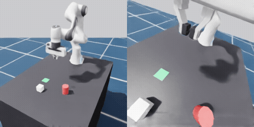
  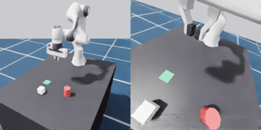
</p>
<p align="center"><sub>Left: <b>Stack, then unstack</b> (4 commands, 2×). Right: the 8-step task. Its "(done)" marks run ahead after four steps and it stops.</sub></p>

<p align="center">
  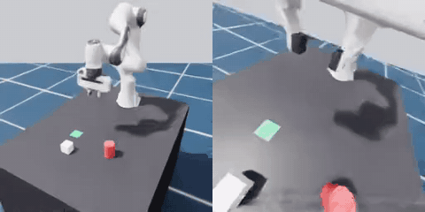
  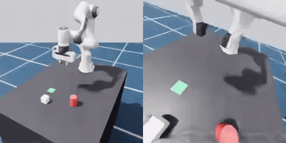
</p>
<p align="center"><sub>Left: <b>Cube to the target</b> (2 commands, 2×). Right: <b>Cube on the can</b> (2 commands, 2×).</sub></p>

**Play with it.** The robot runs live on the [play page](https://theundercover01.github.io/ayushdeshmukh/projects/play/) when my GPU is on. Three games:

- **Sabotage the robot.** It gets a 2-, 4- or 6-step task and you get one sabotage per round: knock the object away or write a fake "(done)". You win if the task isn't really done when it stops. Winning takes understanding how its memory works.
- **Tic-tac-toe.** You're O; the robot has to physically place each X. This robot is a fine-tune of an earlier student, first on the nine board squares, then on 2,000 recordings with flat X / O pieces on the board (had to add extra recordings cuz the perception kept messing up the robot actions).
- **Build a sentence.** Write up to ten commands and watch it work through them.

## 1 · Hypotheses

The question: if a robot is only ever shown single skills, can it carry out a multi-step instruction I never demonstrated?

- **H1. Single-skill clips are enough to learn the skills.** A reward built only from how the object moves in my phone clips can train an RL policy on every skill and on the handoff from one skill to the next.
- **H2. Skills plus handoffs compose.** A VLA distilled from a teacher that only ever ran one or two commands per episode can do longer sentences at inference, because a long task is just more handoffs of kinds it has seen.
- **H3. The missing piece is memory, and it can live in the sentence.** From the camera alone a policy can't tell which step it's on. If the model writes its own progress into its input as "(done)" marks, it can track progress without a planner or an outside counter.

## 2 · Method

<p align="center">
  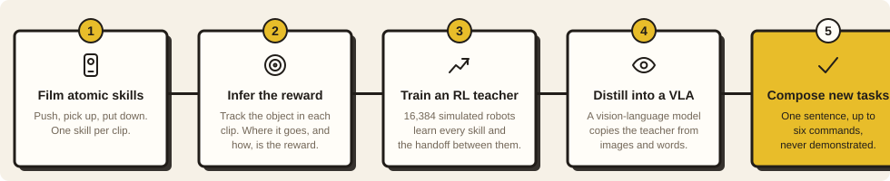
</p>

### 2.1 Clips

<p align="center">
  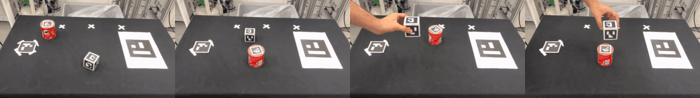
</p>
<p align="center"><sub>Push · Pick up · Put down · Put on the other object</sub></p>

43 usable phone clips of me with a real cube and a crisps (only original flavour was available at Tesco lol) can: 12 pushes, 10 pick-ups, 21 put-downs, I never record two skills in a row. ArUco markers on each object, the target and a calibration marker give each object's position and orientation on the table in every frame.
### 2.2 How is the reward inferred from the clips?

<p align="center">
  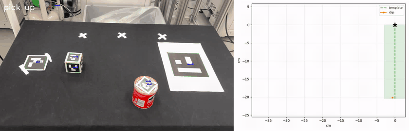
</p>
<p align="center"><sub>The tracked path (orange) and the template the reward uses (green).</sub></p>

Dense, object-centric keypoint reward. The 8 corner keypoints of the commanded object are tracked against a per-skill reference trajectory (start → goal), and the reward is the keypoints' progress along it inside a 3 cm tube (3 cm ≈ the median deviation of my clips from their mean path). Taken from the clips: lift height (≈20 cm), place height, push direction, allowed yaw change. Set by hand: the completion test (keypoint error < ≈2 cm, object speed < 0.1 m/s, held 0.3 s), a per-step time penalty and a per-command completion bonus.

Two changes on top of that:

- **Exploration.** With an object-only reward the signal is zero until first contact; a run from the robot initial pose learned absolutely nothing for 504 iterations :(. I prepend a gripper → object leg (straight-line reference from the TCP to the object centre, same 3 cm tube) and randomize the initial arm configuration every episode.
- **Reward hacking.** The teacher then solved *push* by grasp-and-carry (85 of 100 push episodes lifted the object > 3 cm). A lift penalty that is active only during push commands removed it (0 of 100). 

Before this reward I tried writing a separate reward by hand for each task, and the RL policy found a loophole in every one. Rewarding grasping and carrying made it open and close the gripper right at the release threshold to collect both rewards, without ever finishing. Rewarding distance to the goal made it push the cube onto the target instead of lifting it (see [What didn't work](#45-what-didnt-work)). The keypoint reward uses the same formula for every command; only the template changes. There are three templates, one per skill (push, pick up, put down), each is measured from the clips. The current command picks the template and fills in the rest: *put the cube on the cylinder* uses the put-down template, applied to the cube, ending on top of the cylinder. Chaining commands just switches templates. It only scores where the object goes, so it doesn't depend on the robot's body.

**You might be wondering how I make sure no two commands** Every training episode starts with the hand empty (a random arm pose; in 10% one object already stacked on the other), so the first command is always a pick-up or a push. The second command follows a fixed rule: after *pick up X* comes *put X down* (on the target or on the other object); after a push comes a pick-up. So the teacher never sees two pushes, a push after a pick-up, or a put-down of something it isn't holding. The long evaluation sentences and the sentence builder in the games follow the same rules.

### 2.3 RL teacher

A Franka Panda in Isaac Lab, PPO with 16,384 simulated robots in parallel, 1000 iterations. The teachers observations are: the exact object positions, the next point on the path and the current command. Each episode has one or two commands, so it learns every skill and the handoff between two of them.

RL is cheap here because the teacher sees everything. Running RL directly on a 450M-parameter model that only sees images would be far slower, so the teacher does the trial and error, and distillation turns it into a data source: I can record as many labelled episodes as I want, from any layout.

### 2.4 Distillation

SmolVLA, starting from the public `smolvla_base` weights, trained for 32K steps on 4,500 teacher episodes. It sees a front camera, a wrist camera and the sentence: no positions and no step counter.

The 4,500 are split 3,000 + 1,500 on purpose. The 3,000 are *paired*: every scene is recorded twice, once with "the cube" in the sentence and once with "the cylinder". The images are the same, so the only way to know which object to move is to read the sentence (in an earlier version this took picking the right object from 45 to 80 of 100). The extra 1,500 are pushes, the weakest skill; in an earlier version more push data took push from 23 to 44.

**Smoothing the teacher first.** The RL teacher learned jerky control: at each step it often slams a motion command all the way one way, then all the way the other. The arm still gets where it needs to go, so the teacher works. But to a student copying it, the commands jump back and forth almost at random, and the VLA learned nothing better than the average command. The fix: the arm doesn't carry out each new command directly. Every step it moves only 5% of the way toward the new command and keeps 95% of its previous motion. The jerky commands blur into one smooth motion, and the student learns to copy that smooth motion instead. The teacher is trained with this smoothing on, so it learns to work with it. A simpler option I didn't try (just hit me lol): keep the teacher as it was and label each frame with how the arm actually moved, not with what the policy asked for. The arm can't follow a command that flips every step, so its real motion is already smoother, and the teacher wouldn't need retraining.

### 2.5 Memory: "(done)" marks in the sentence

The model has one extra output, "is the current step done?". In training it is 1 for the half-second before the teacher moved on to its next command. At inference, when it stays above 0.85 for half a second, "(done)" is written after the current command, and the next time the model reads:

> ~~pick up the cube~~ **(done)**, then ~~put the cube on the cylinder~~ **(done)**, then **pick up the cube** ← now, then put the cube on the target

The first command without a mark is the one to do. But a training episode has only one or two real commands, while a test sentence has up to eight. So in training the real commands are hidden inside a longer sentence of up to 10: random commands before them, already marked "(done)", and random ones after. For an episode that really does *pick up the cube, then put the cube on the target*, the student might read:

> push the cube to the target **(done)**, then pick up the cylinder **(done)**, then put the cylinder on the cube **(done)**, then **pick up the cube**, then put the cube on the target, then pick up the cylinder

The number of commands in front is random, so the current command shows up at every position from 1 to 10 equally often. An earlier version padded at most 3 in front; it never saw a current command at position 6, and scored 5 of 100 on the 6-step task.

<p align="center">
  
  
</p>
<p align="center"><sub>Left: <b>Marks off</b> (3×): stuck on command one. Right: <b>Its own marks</b> (3×): all six in order.</sub></p>

## 3 · Experimental setup

100 validation layouts per task, the arm starts at home, the whole sentence is given once, and each run has 6 s per command plus 5 s. Two scores: **in order** (the headline: every command done, one after the other, as counted by the simulator; the robot's own marks don't count) and **lenient** (only the final scene, if acheved, is considered as success). For 6 steps: 40 in order, 49 lenient.

| Command | Counts as done when |
| :--- | :--- |
| pick up | raised at least 4 cm |
| on / pushed to the target | within 5 cm of its centre |
| on the other object | within 5 cm, and within ±3 cm of resting height on top |
| every result | held for 0.2 s |

This is a loose check. With my first, strict check (1.5 cm, 0.5 s) the EXACT same model scores 12 on the 6-step task, 24 with the teacher's own check, 40 with this one: its put-downs are slightly off, not failed. Only the judge is looser; the robot's own done signal is unchanged, and the teacher is scored the same way.

**Why loosen it at all?** The strict check was stricter than what the teacher itself learned to call "done". The teacher's completion test accepts an object up to about 2 cm from its resting pose after 0.3 s; the strict check wanted 1.5 cm for 0.5 s. The student learns "done" from the teacher's recordings, so it marks a put-down done exactly where the teacher would. I checked where the cube actually was each time the student wrote "(done)" after putting it on the cylinder. When the strict check agreed, the cube was 0.7 cm above its resting height (median). When the strict check disagreed, it was 1.7 cm above: just outside the strict 1.5 cm, but well inside the teacher's own 2 cm. Because the in-order score stops at the first rejected command, one put-down a few millimetres high failed every later command too. The loose check judges whether the task got done, not whether a cube landed within 1.5 cm.

## 4 · Analysis

### 4.1 H1: the skills are learnable from clips (supported)

The teacher, trained only on the clip-derived reward, does every single skill 100 of 100 and chains them: 94 of 100 on the 6-step task and 100 of 100 on the 8-step one. Single-skill clips are enough to learn the skills and the handoffs.

### 4.2 H2: skills compose, up to a point (partly supported)

The student composes tasks it never saw: 62 on 3 steps, 81 on 4, 40 on 6. But it drops to 0 on 8, while the teacher stays at 100. The skills transfer; something else limits length.

### 4.3 H3: memory in the sentence works, and it's the bottleneck (supported, sort off)

From the camera alone you can't tell where you are. In the 6-step task the arm reaches for the cube in step 1 and again in step 3, and the scenes look almost the same; after step 4 the board looks exactly like a finished 4-step task. So the model needs some way to know which step it's on. I tried five, and scored each on the 4-step and the 6-step sentence (all commands done, in order, out of 100):

| What I gave the model so it knows where it is | 4 steps | 6 steps |
| :--- | :---: | :---: |
| Nothing extra, just the whole sentence | 1 | 0 |
| Older camera frames and its own past actions | ≈0 | ≈0 |
| One command at a time, fed by a script that moves on when the model says "done" (the memory sits outside the model) | 65 | 38 |
| A counter in its input: "k steps done" | 42 | 0 |
| **Its own "(done)" marks, written into the sentence** | **81** | **40** |

With nothing extra it can't tell step 1 from step 3 and keeps redoing the start. Old frames don't help: a frame from a second ago doesn't say which step that was either. The counter works for short sentences but had never seen a count of 5, so the 6-step task fails. The "(done)" marks beat everything, including the script, and the memory stays inside the model's own input. Only the last row is the final model; the others are earlier versions of the same pipeline.

**Does the done task help?** The model really uses its marks (I tested on an earlier model with the same recipe). With marking switched off the 4-step task never finishes (0 of 50); with the first two marks written in advance it skips straight to step 3 and finishes 42 of 50.

<p align="center">
  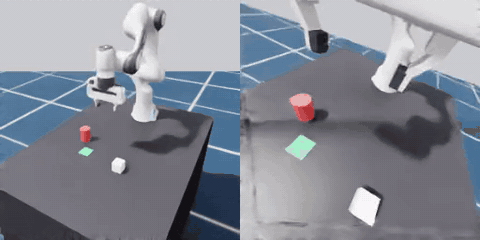
  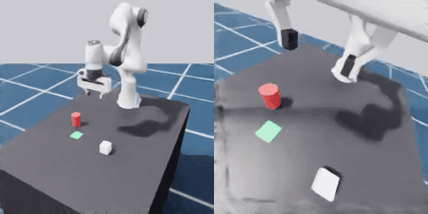
</p>
<p align="center"><sub>Left: <b>Knocked away after it was done</b> (2×). Right: <b>Dropped mid-carry</b> (2×).</sub></p>

The limit is the done signal itself. It fires when an object is lifted and held still, whichever command is current, so it reads the image more than the sentence. On the 8-step sentence (*"pick up the cube, then put the cube on the cylinder, then pick up the cube, then put the cube on the target, then pick up the cube, then put the cube on the cylinder, then pick up the cube, then put the cube on the target"*) the marks reach 8 of 8 after four steps and the robot stops; in 60 of 100 runs exactly four steps were done in order.

### 4.4 Where the 6-step runs fail

So you don't have to scroll back up, the 6-step sentence is:

> "pick up the cube, then put the cube on the cylinder, then pick up the cube, then put the cube on the target, then pick up the cylinder, then put the cylinder on the cube"

<p align="center">
  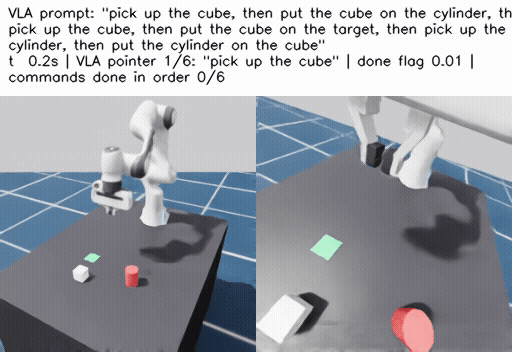
  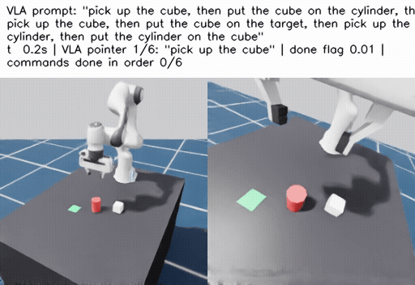
</p>
<p align="center"><sub>Left: <b>Knocks the cylinder over</b> at command five (3×). Right: <b>Marked done too early</b>, so a step is skipped (3×).</sub></p>

Of 100 runs, the failures stop at step 5, picking up the cylinder (25), step 4 (15) and step 2 (13); 21 runs knock something over. Two causes: early marks, and the cylinder, the weakest object (pick up 59, to the target 77, onto the cube 81, against 94–97 for the cube).

### 4.5 What didn't work

<table>
<tr><td width="33%" valign="top">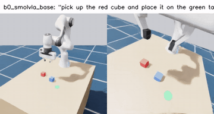<br><sub><b>1.</b> Base SmolVLA, no fine-tuning: the arm wanders.</sub></td><td width="33%" valign="top">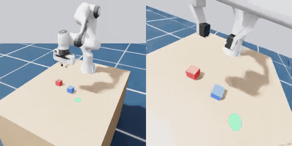<br><sub><b>2.</b> Reward for grasping and carrying: never lets go.</sub></td><td width="33%" valign="top">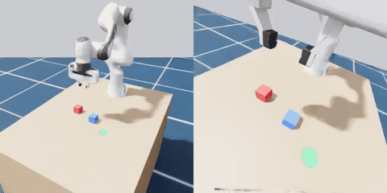<br><sub><b>3.</b> Reward for distance to the goal: pushes instead of lifting.</sub></td></tr>
<tr><td width="33%" valign="top">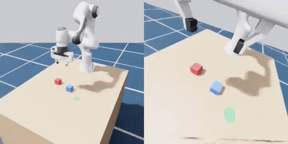<br><sub><b>4.</b> Motion-primitive actions: lifts the cube and holds it up forever.</sub></td><td width="33%" valign="top">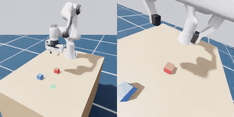<br><sub><b>5.</b> 2 cm "arrived" radius: grabs the top edge, the cube slips.</sub></td><td width="33%" valign="top">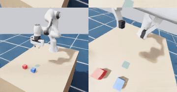<br><sub><b>6.</b> No paired episodes: asked for the red cube, carries the blue one.</sub></td></tr>
<tr><td width="33%" valign="top">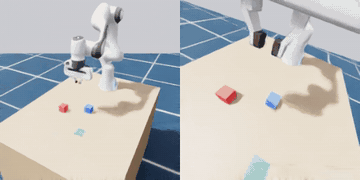<br><sub><b>7.</b> Whole sentence, no memory: 0 of 6 steps in order.</sub></td><td width="33%" valign="top">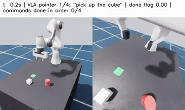<br><sub><b>8.</b> One command at a time: the flag fires early, the script is at step 4 with 1 done.</sub></td><td width="33%" valign="top">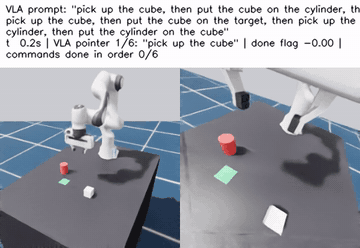<br><sub><b>9.</b> A step count in the input: reaches 5 of 6, never 6.</sub></td></tr>
<tr><td width="33%" valign="top">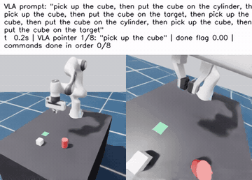<br><sub><b>10.</b> Stricter put-down from the clips: marks run to 8 of 8 with 4 done.</sub></td><td width="33%" valign="top">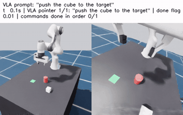<br><sub><b>11.</b> Teacher without the no-lift penalty: student pushes over the objects, still marks done.</sub></td></tr>
</table>

| Attempt | Result | Video |
| :--- | :--- | :---: |
| Base SmolVLA, no fine-tuning | 0 on every task | 1 |
| Fine-tune the VLA directly on single skills | push 16, pick-up 0, every combined task 0 | |
| Clean scripted demos | 6 on 2-step tasks: it never saw a mistake, so it couldn't recover | |
| Reward for grasping and carrying | toggled the gripper on the release threshold to collect both rewards, 0 | 2 |
| Reward for distance to the goal | pushed instead of lifting, 19 | 3 |
| Motion-primitive vocabulary | ~75% of successes were pushes; often lifts and never puts down | 4 |
| First clip reward, 2 cm "arrived" radius | the hand stops 1–2 cm above the cube's centre; pick-up 0% | 5 |
| Imitating raw RL actions | 0 on everything but push (14) | |
| Action-change penalty / smoothing labels afterwards | loss 0.93 → 0.77, same poor fit | |
| No paired episodes | picks the named object only about half the time (chance) | 6 |
| Whole sentence, no memory | 4 steps 14, 6 steps 12; almost never in order | 7 |
| One command at a time, the model's done flag moves the script on | 4 steps 21 in order (65 with a stricter flag), and the memory is outside the model | 8 |
| A step count in the input ("k done") | 6 steps: 5 | 9 |
| Rest speed and hold time from the clips | student 4 steps 17/50, 6 steps 7/50 | |
| Stricter put-down from the clips (1.34 cm) | better teacher; student stalls at step 3–4 of 6 | 10 |
| Teacher without the no-lift penalty on pushes | it grasped and carried instead of pushing; student push 16 | 11 |
| Camera history, unfrozen vision | worse than the plain student | |
| Padding to 20 commands | short tasks drop (cube on cylinder 75 → 42) | |
| Stricter done signal (10–15 steps) | many runs never mark | |
| Voting over 3 samples, re-arming, self-check | no gain | |
| "(in progress)" tag on the current command | no change | |
| Random pauses + the same image under two sentences | the signal stops firing; 4 steps 51 → 11 | |

…and a lot more that didn't work. These are the ones worth knowing about.

## 5 · Limitations

- **"Done" has no time dimension, so the robot never learns to let go.** A step is complete when the object reaches its goal pose and comes to rest. The test never looks at the gripper (which is a limitation of the object-centric reward), and it never asks the object to *stay* there once the next step starts. Releasing the object earns nothing. Example: *pick up the cube, put the cube on the target, pick up the cylinder, put the cylinder on the cube.* The cube reaches the target and gets marked done while still in the gripper. The robot then drags it toward the cylinder, opens whenever it happens to, grasps the cylinder and puts it on the cube wherever the cube now is. Object-centric goals need a spatio-temporal part: where the object has to be, and for how long (until the task ends or a later step moves it). The scoring has the same blind spot. A step counts once its result holds for 0.2 s, so this run can still score as a success.
- **8 steps: 0 of 100.** The done signal follows the image, not the sentence. On the 8-step task, 60 of 100 runs stop at exactly 4 steps in order while the marks have already reached 8 of 8. The scene after step 4 looks like a finished 4-step task, so the model marks the rest done (see [section 4.3](#43-h3-memory-in-the-sentence-works-and-its-the-bottleneck-supported-sort-off)).
- **No undo.** A wrong "(done)" is never taken back, so the skipped step is never redone. A self-check that erases wrong marks finds them (93–100% correct), but the robot doesn't complete the step on the second try.
- **The headline uses a loose check.** Positions within 5 cm and results held 0.2 s. With 1.5 cm / 0.5 s the 6-step score is 12 in order, not 40 (see [Experimental setup](#3--experimental-setup)).
- **Cylinder and pushing are weak** (59 each, the teacher gets 100). Grasped too high, the cylinder tips, and once it's on its side it can't be picked up (never in the data). Most sentences that start with the cylinder fail.
- **Not every part of the reward comes from the clips.** The completion thresholds, time penalty, completion bonus and the gripper to object leg are set by hand. So is the no-lift penalty on push commands: the clips never show a push turning into a lift, but nothing in them says "don't lift" either, so I added it by hand after the teacher learned to grasp and carry instead of pushing.
- **One scene, in simulation.** One cube, one cylinder, a fixed target, two fixed cameras. Anything new on the table hurts the results.

## 6 · Future work

1. **A done judge.** A small separate model, image + sentence → "is the current step finished?", trained with frames from the *other* steps as negatives, so it has to read the text.
3. **Undo.** A self-check already erases mostly wrong marks (93–100% of them really weren't done); it needs to redo the step too.
4. **More cylinder data**, and a teacher that grasps it lower so it doesn't tip. Or a cleaner solution may be to lean to place the cylinder upright regarless of orientation.
5. **Varied scenes** in the recordings (distractors, textures, lighting); one fine-tune on new pieces was enough to fix them.
6. **A real robot.** The clips are real; the robot isn't yet.

## Reproduce

Two Python environments: Isaac Lab 2.3.2 / Isaac Sim 5.1 (simulation, RL) and LeRobot 0.6.2 (SmolVLA). Two 24 GB GPUs.

The repo includes the tracked clips (`data/processed/clips_real/`, 43 clips), the reward template built from them, and the state bank file the simulator loads. The raw phone videos and the trained weights are not included.

```bash
# 1. clips -> reward template (rebuilding it from the included clips gives the same file)
python -m motion.keypoint_ref --clips data/processed/clips_real --straight --out data/processed/keypoint_ref_real_straight.npz

#    or from your own phone videos: cut the takes, calibrate, track the ArUco markers
python -m handtrack.cut_session <video> --out <clips>/<name>
python -m handtrack.calibrate_session <clips> --f 2000 --out <clips>/session_calib.npz
python -m handtrack.make_clips <clips> --calib <clips>/session_calib.npz --out data/processed/clips_real

# 2. teacher -> 4,500 recordings -> student -> evals (about 10 h)
setsid nohup scripts/run_nolift_pipeline.sh > /dev/null 2>&1 < /dev/null &

# 3. the loose check behind every number in this README
NAME=ours_cyl_marks_nolift G=0 scripts/eval_cliptol_loose.sh
G=0 scripts/eval_teacher_loose.sh

# 4. the live games (the tic-tac-toe robot first needs scripts/run_ttt_pipeline.sh, then scripts/run_ttt_tiles_pipeline.sh)
play/run_sabotage.sh start; play/run_builder.sh start; play/run_tictactoe.sh start ours_cyl_marks_ttt_tiles
PUSH=1 play/run_tunnels.sh start; setsid nohup play/watchdog.sh > /dev/null 2>&1 < /dev/null &
```

| Step | Code |
| :--- | :--- |
| Clip tracking | `handtrack/`, `motion/keypoint_ref.py` |
| Teacher | `sim/envs/keypoint_env.py`, `sim/train_rl.py` |
| Recording | `sim/record_keypoint_rollouts.py` |
| Student | `vla/build_dataset.py --prompt_mode marks`, `scripts/distill_place.sh` |
| Eval | `sim/eval_chains.py --learned_done --marks --whole_prompt` |
| Games | `play/` |

Paths in the scripts point to my machine; change them to yours: the cache and data folders (`C=`, `D=`), the LeRobot Python (`PY=`) and the Isaac Lab install (`ISAACLAB=` in `scripts/run_isaac.sh`).

## Related work

Learning from Play (Lynch et al. 2019), SPiRL, LAPA, Exp2VLA, VLA-OPD, SimpleVLA-RL, SmolVLA (LeRobot).
